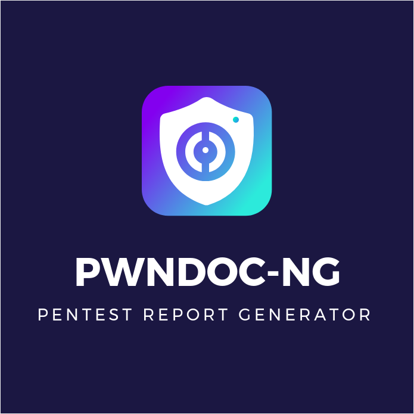
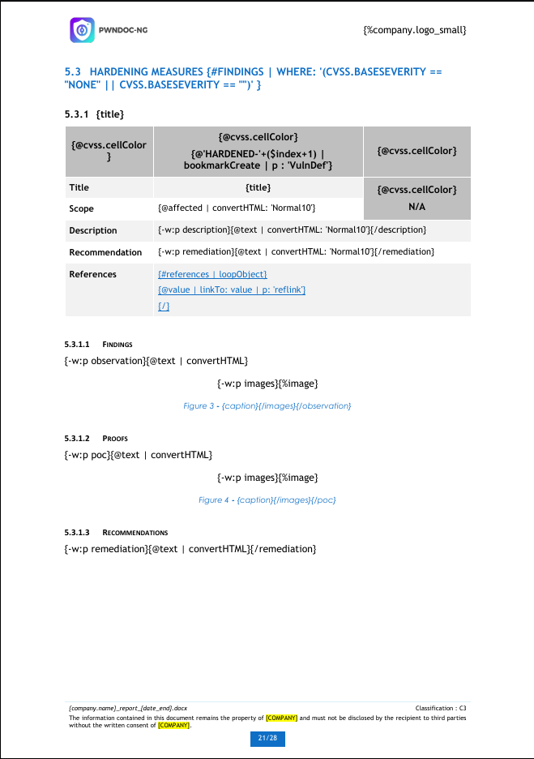
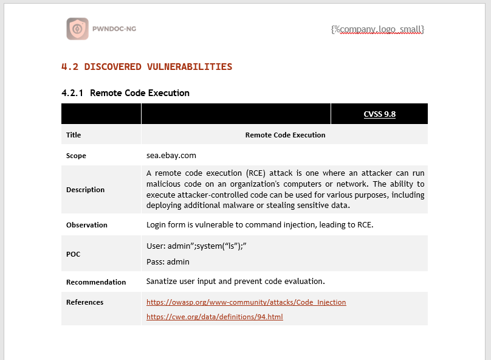
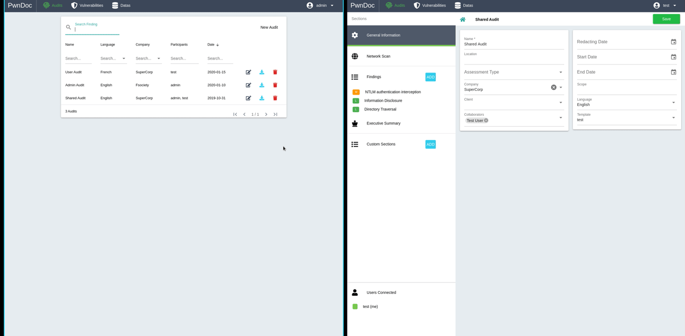
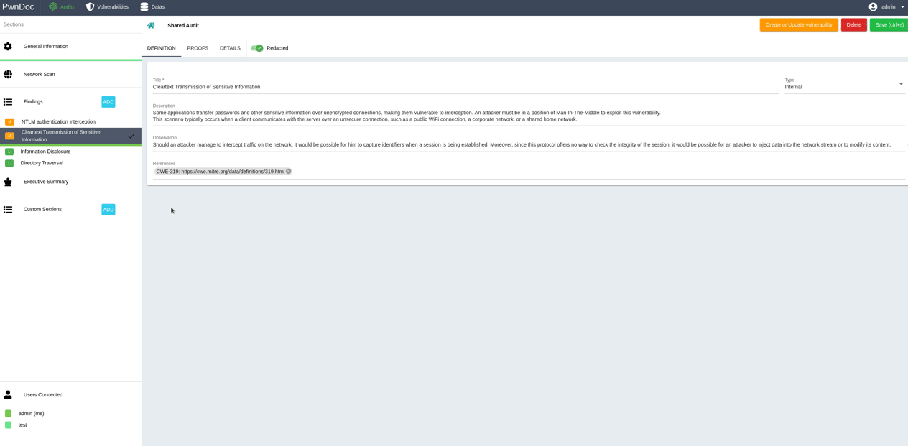
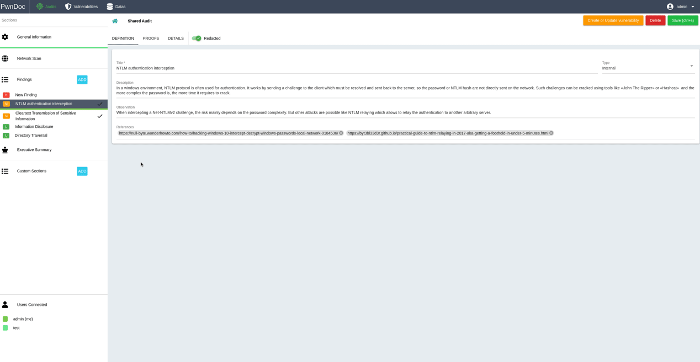

# PwnDoc-ng



PwnDoc-ng is a pentest reporting application making it simple and easy to write your findings and generate a customizable Docx report. It is based on original fork of [PwnDoc](https://github.com/pwndoc/pwndoc) work by [yeln4ts](https://github.com/yeln4ts).
The main goal is to have more time to **Pwn** and less time to **Doc** by mutualizing data like vulnerabilities between users.

PwnDoc was originally maintained by its creator. After months of absence, with issues and pull requests piling up, we opened this maintained fork.


| Example Template  | Generated document |
| ------------- | ------------- |
|   | 


## Features

- **Collaborative editing**: several users write the same audit in real time (TipTap 3, Hocuspocus/Yjs), WYSIWYG editor with tables, images with captions, bar and pie charts, spellchecker (LanguageTool) and code blocks with syntax highlighting (css, js, http, ts, html, bash, sql, json: choose the language in the menu of the code block)
- **Links between findings**: with `{@identifier | bookmarkCreate | p}` in the template, type `:::` in the editor to link another finding with a hyperlink

  
- **Audits**: audit types, custom sections and custom fields, Nmap/Nessus scan import, CVSS v3.1 scores, audit cloning
- **Reviews**: comments on the text and the images of an audit, approvals (mandatory review, minimum number of reviewers, approval blocked while comments are open)
- **Vulnerability database**: reusable vulnerabilities in several languages, vulnerability types with rich text descriptions, proposals from the audits reviewed field by field, archives
- **Docx reports**: customizable templates (tables, charts, captions, links between findings, CVSS and remediation colors, named table styles)
- **Users and security**: roles and permissions, two-factor authentication (TOTP), images readable only by the users of their audits, JWT secrets from environment variables
- **Backups**: full or partial backups of any size, stored on the server, optionally encrypted with a password, with a progress bar; restore by merge or replace; automatic backups on a schedule with rotation (daily and weekly)
- **Database**: MongoDB 8, data stored on the host in `mongodb/mongo-data`, transparent migration of MongoDB 4.x data
- **Languages**: English, French, German, Chinese and Brazilian Portuguese

Thanks to all the contributors, among them @Syzik (remediation complexity colors) and @noraj (mongo-data volume).

## Quick start

```bash
git clone https://github.com/pwndoc-ng/pwndoc-ng.git
cd pwndoc-ng
docker compose up -d --build
```

The application is available at https://localhost:8443: the first user created is the administrator. For production, replace the certificates in `backend/ssl` and set the [JWT secrets](https://pwndoc-ng.github.io/pwndoc-ng/#/installation?id=jwt-secrets).

> [!IMPORTANT]
> Updating an installation using MongoDB 4.x? Make a backup, then read [Update to MongoDB 8](https://pwndoc-ng.github.io/pwndoc-ng/#/installation?id=update-to-mongodb-8) before updating.

## Documentation

- [Installation](https://pwndoc-ng.github.io/pwndoc-ng/#/installation) (update, backups, tests)
- [Data](https://pwndoc-ng.github.io/pwndoc-ng/#/data)
- [Roles](https://pwndoc-ng.github.io/pwndoc-ng/#/roles)
- [Vulnerabilities](https://pwndoc-ng.github.io/pwndoc-ng/#/vulnerabilities)
- [Audits](https://pwndoc-ng.github.io/pwndoc-ng/#/audits)
- [Templating](https://pwndoc-ng.github.io/pwndoc-ng/#/docxtemplate)
- [Debug](https://pwndoc-ng.github.io/pwndoc-ng/#/debug)

## Demos

### Multi-User reporting


### Finding edition


### Vulnerability management workflow


## Contribute

### Developing with docker compose

```bash
docker compose -f docker-compose-dev.yml up
```

The source code is reloaded on changes.

### Tests

Each test suite runs in its own containers, with its own database:

- backend (Jest): `./run_tests.sh -f` (stops the containers of the application first)
- frontend (Vitest): see [Tests](https://pwndoc-ng.github.io/pwndoc-ng/#/installation?id=tests)
- end-to-end (Playwright): `./e2e/run.sh`

Feel free to contribute :).
